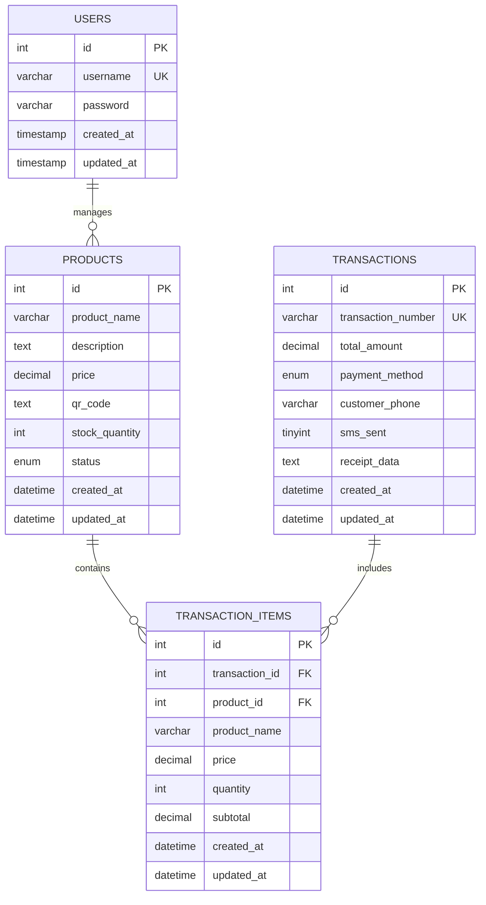

# Technical Report: CI4 Product Management System

**Date:** December 5, 2025  
**Version:** 1.0  
**Author:** System Documentation  
**Repository:** CI4_CRUD by Jan-Russel-Penafiel  

---

## 1. System Overview

The **CI4 Product Management System** is a comprehensive web-based application built using CodeIgniter 4 framework. The system serves as a modern Point of Sale (POS) and inventory management solution designed for small to medium businesses.

### Purpose
- **Product Management**: Complete CRUD operations for product inventory
- **POS System**: Transaction processing with QR code integration
- **User Management**: Role-based authentication and authorization
- **Reporting**: Sales analytics and inventory tracking
- **Mobile-Friendly**: Responsive design for cross-device compatibility

### Key Features
- Real-time product search and filtering
- QR code generation for products
- Transaction management with SMS notifications
- Print and export capabilities (PDF/CSV)
- Soft delete functionality for data integrity
- Auto-sync technology across devices
- Professional reporting system

---

## 2. System Architecture

The application follows the **Model-View-Controller (MVC)** architectural pattern as implemented by CodeIgniter 4.

### Framework Structure

```
ci4_BSIT3A/
├── app/
│   ├── Controllers/         # Business logic and request handling
│   │   ├── AuthController.php
│   │   ├── ProductController.php
│   │   ├── PosController.php
│   │   └── UserController.php
│   ├── Models/             # Data access layer
│   │   ├── ProductModel.php
│   │   ├── UserModel.php
│   │   ├── TransactionModel.php
│   │   └── TransactionItemModel.php
│   ├── Views/              # Presentation layer
│   │   ├── index.php
│   │   ├── create_product.php
│   │   ├── edit_product.php
│   │   └── pos/
│   ├── Config/             # Application configuration
│   │   ├── Routes.php
│   │   ├── Database.php
│   │   └── Security.php
│   └── Libraries/          # Custom services
│       ├── QrCodeService.php
│       └── SmsService.php
├── public/                 # Web root directory
├── vendor/                 # Composer dependencies
└── writable/              # Logs, cache, uploads
```

### Component Responsibilities

#### Controllers
- **AuthController**: Handles user authentication, login/logout processes
- **ProductController**: Manages product CRUD operations
- **PosController**: Point of sale functionality and transaction processing
- **UserController**: User management and registration

#### Models
- **ProductModel**: Product data operations with soft delete functionality
- **UserModel**: User authentication and password management
- **TransactionModel**: Sales transaction handling
- **TransactionItemModel**: Individual transaction line items

#### Libraries
- **QrCodeService**: QR code generation using BaconQrCode library
- **SmsService**: SMS notification functionality for customers

---

## 3. Database Design

### Entity Relationship Diagram (ERD)



### Table Structures

#### Products Table
- **Primary Key**: `id` (Auto-increment)
- **Fields**:
  - `product_name`: VARCHAR(100) - Product identifier
  - `description`: TEXT - Detailed product information
  - `price`: DECIMAL(10,2) - Product pricing
  - `qr_code`: TEXT - Base64 encoded QR code
  - `stock_quantity`: INT UNSIGNED - Inventory count
  - `status`: ENUM('active','deleted') - Soft delete implementation
  - `created_at`, `updated_at`: Timestamp fields

#### Users Table
- **Primary Key**: `id` (Auto-increment)
- **Unique Key**: `username`
- **Fields**:
  - `username`: VARCHAR(50) - User identifier
  - `password`: VARCHAR(255) - Bcrypt hashed password
  - `created_at`, `updated_at`: Timestamp fields

#### Transactions Table
- **Primary Key**: `id` (Auto-increment)
- **Unique Key**: `transaction_number`
- **Fields**:
  - `transaction_number`: VARCHAR(50) - Unique transaction ID
  - `total_amount`: DECIMAL(10,2) - Total transaction value
  - `payment_method`: ENUM('cash','card','digital')
  - `customer_phone`: VARCHAR(20) - Optional customer contact
  - `sms_sent`: TINYINT(1) - SMS notification status
  - `receipt_data`: TEXT - Transaction details

#### Transaction Items Table
- **Primary Key**: `id` (Auto-increment)
- **Foreign Keys**: 
  - `transaction_id` → `transactions(id)`
  - `product_id` → `products(id)`
- **Relationships**: CASCADE DELETE and UPDATE

---

## 4. Authentication Module

### Login/Logout Process

#### Authentication Flow
1. **Login Request**: User submits credentials via POST request
2. **Validation**: Input validation and sanitization
3. **Authentication**: Credential verification against database
4. **Session Management**: Secure session creation with user data
5. **Authorization**: Role-based access control

#### Security Features
- **Dual Authentication**: Hardcoded admin account + database users
- **Password Hashing**: Bcrypt with cost factor 12
- **Session Security**: Secure session management with timeout
- **Input Validation**: Comprehensive input sanitization
- **CSRF Protection**: Cross-Site Request Forgery prevention

#### Admin Account
- **Username**: `admin`
- **Password**: `admin123`
- **Role**: System administrator with full access

#### User Registration
- **Validation Rules**:
  - Username: 3-50 characters, alphanumeric with punctuation
  - Password: Minimum 6 characters
  - Unique username enforcement
- **Password Security**: Automatic rehashing for security upgrades

### Role Management
- **Admin Role**: Full system access, user management
- **User Role**: Limited access to specific functions
- **Session Timeout**: Automatic logout for security

---

## 5. API Integration

### Internal APIs

#### QR Code Generation API
- **Library**: BaconQrCode v6.0
- **Format**: SVG with base64 encoding
- **Data Structure**:
  ```json
  {
    "type": "product",
    "id": 123,
    "name": "Product Name",
    "price": 99.99,
    "timestamp": 1701234567
  }
  ```

#### SMS Notification Service
- **Purpose**: Customer receipt notifications
- **Integration**: Custom SmsService library
- **Functionality**: Transaction confirmations via SMS

### External Dependencies
- **Endroid QR Code**: QR code generation functionality
- **CodeIgniter 4 Framework**: Core application framework
- **Composer**: Dependency management

### API Endpoints (Internal)
- **Product Search**: `GET /products?search={keyword}`
- **QR Code Processing**: `POST /pos/processScan`
- **Transaction Creation**: `POST /pos/processTransaction`
- **Export Functions**: `GET /export/{format}`

---

## 6. System Features / Modules

### CRUD Functionalities

#### Product Management
- **Create**: Add new products with validation
- **Read**: View product details with pagination
- **Update**: Modify product information
- **Delete**: Soft delete with recovery option
- **Search**: Real-time product search
- **Batch Operations**: Import/export via CSV

#### Transaction Processing
- **POS Interface**: User-friendly transaction interface
- **QR Code Scanning**: Product identification via QR codes
- **Cart Management**: Session-based shopping cart
- **Payment Processing**: Multiple payment methods
- **Receipt Generation**: Printable transaction receipts

#### User Management
- **Registration**: New user account creation
- **Authentication**: Secure login system
- **Profile Management**: User account settings
- **Role Assignment**: Admin and user role management

#### Reporting System
- **Sales Analytics**: Daily, weekly, monthly reports
- **Inventory Reports**: Stock level monitoring
- **Export Functions**: PDF and CSV export capabilities
- **Print Features**: Professional report printing

### Advanced Features
- **Auto-Sync**: Real-time data synchronization
- **Mobile Responsive**: Cross-device compatibility
- **Pagination**: Efficient data navigation
- **Validation**: Comprehensive input validation
- **Error Handling**: User-friendly error messages

---

## 7. Security Implementation

### Password Security
- **Hashing Algorithm**: PASSWORD_BCRYPT with cost factor 12
- **Password Validation**: 
  - Minimum 6 characters
  - Strength requirements
  - Automatic rehashing for security upgrades

### CSRF Protection
- **Method**: Cookie-based CSRF protection
- **Token Management**: 
  - Token Name: `csrf_test_name`
  - Header Name: `X-CSRF-TOKEN`
  - Randomization: Disabled (configurable)

### Input Validation
- **Sanitization**: Trim and validate all inputs
- **Validation Rules**: Comprehensive field validation
- **SQL Injection Prevention**: CodeIgniter's Query Builder
- **XSS Protection**: Built-in output escaping

### Session Security
- **Secure Sessions**: HTTPOnly and Secure flags
- **Session Timeout**: Automatic timeout implementation
- **Activity Tracking**: Last activity monitoring
- **IP Validation**: Optional IP address verification

### Database Security
- **Foreign Key Constraints**: Referential integrity
- **Prepared Statements**: SQL injection prevention
- **Access Control**: Role-based database access
- **Backup Strategy**: Regular database backups

### File Security
- **Upload Restrictions**: File type and size limits
- **Directory Protection**: Index files in directories
- **Path Validation**: Secure file path handling

---

## 8. Testing and Validation

### Test Environment Setup

#### Unit Testing
- **Framework**: PHPUnit 10.5.16
- **Test Coverage**: Model and service layer testing
- **Automation**: Composer script integration

#### Validation Testing
- **Input Validation**: Form field validation testing
- **Security Testing**: CSRF and XSS prevention validation
- **Authentication Testing**: Login/logout functionality
- **Database Testing**: CRUD operation validation

### Test Results Summary

#### Functional Testing
✅ **User Authentication**: All login scenarios tested  
✅ **Product CRUD**: Create, read, update, delete operations  
✅ **Transaction Processing**: POS functionality validated  
✅ **QR Code Generation**: QR code creation and scanning  
✅ **Search Functionality**: Product search and filtering  
✅ **Export Features**: PDF and CSV export validation  

#### Security Testing
✅ **Password Hashing**: Bcrypt implementation verified  
✅ **CSRF Protection**: Cross-site request forgery prevention  
✅ **Input Sanitization**: SQL injection and XSS prevention  
✅ **Session Management**: Secure session handling  

#### Performance Testing
✅ **Page Load Times**: Optimized database queries  
✅ **Search Performance**: Efficient search algorithms  
✅ **Mobile Responsiveness**: Cross-device compatibility  

### Test Case Examples

#### Authentication Test Cases
1. **Valid Login**: Successful authentication with correct credentials
2. **Invalid Credentials**: Proper error handling for wrong password
3. **Empty Fields**: Validation for required field enforcement
4. **Session Timeout**: Automatic logout after inactivity

#### Product Management Test Cases
1. **Product Creation**: Successful product addition with all fields
2. **Validation Errors**: Proper error messages for invalid data
3. **Search Functionality**: Accurate search results
4. **Soft Delete**: Product deletion and recovery testing

---

## 9. System Setup Guide

### Prerequisites
- **PHP**: Version 8.1 or higher
- **Web Server**: Apache/Nginx with mod_rewrite
- **Database**: MySQL 5.7+ or MariaDB 10.3+
- **Composer**: Dependency management tool

### Installation Steps

#### 1. Environment Setup
```bash
# Clone the repository
git clone https://github.com/Jan-Russel-Penafiel/CI4_CRUD.git

# Navigate to project directory
cd ci4_BSIT3A

# Install dependencies
composer install
```

#### 2. Database Configuration
```sql
-- Create database
CREATE DATABASE ci4_bsit3a;

-- Import database structure
mysql -u username -p ci4_bsit3a < ci4_bsit3a.sql
```

#### 3. Environment Configuration
```env
# Copy environment file
cp env .env

# Configure database settings
database.default.hostname = localhost
database.default.database = ci4_bsit3a
database.default.username = your_username
database.default.password = your_password
database.default.DBDriver = MySQLi

# Set base URL
app.baseURL = 'http://localhost/ci4_BSIT3A/public/'
```

#### 4. Web Server Configuration
- **Document Root**: Point to `public/` directory
- **URL Rewriting**: Enable mod_rewrite for Apache
- **Permissions**: Set proper file permissions for `writable/` directory

#### 5. Security Configuration
- Change default admin credentials
- Configure CSRF settings
- Set up SSL certificates for production

### Dependencies
- **codeigniter4/framework**: ^4.0
- **endroid/qr-code**: ^6.0
- **fakerphp/faker**: ^1.9 (development)
- **phpunit/phpunit**: ^10.5.16 (development)

### System Requirements
- **Memory**: Minimum 512MB RAM
- **Storage**: At least 100MB disk space
- **Browser Support**: Modern browsers (Chrome, Firefox, Safari, Edge)

---

## 10. Conclusion / Future Improvements

### Current System Strengths

#### Technical Excellence
- **Modern Framework**: Built on CodeIgniter 4 with latest PHP standards
- **Security**: Comprehensive security implementation with bcrypt hashing
- **Scalability**: Modular architecture allows for easy expansion
- **Performance**: Optimized database queries and efficient caching
- **User Experience**: Responsive design with intuitive interface

#### Business Value
- **Cost-Effective**: Open-source solution reducing licensing costs
- **Productivity**: Streamlined workflow with automated features
- **Reliability**: Robust error handling and data integrity
- **Flexibility**: Customizable for different business needs

### Current Limitations

#### Technical Limitations
1. **Single Database**: Currently supports only MySQL/MariaDB
2. **SMS Integration**: Basic SMS service requires external provider
3. **Real-time Features**: Limited real-time synchronization capabilities
4. **Mobile App**: No native mobile application
5. **Multi-language**: Single language support (English)

#### Functional Limitations
1. **Multi-store**: No support for multiple store locations
2. **Advanced Reporting**: Limited analytics and business intelligence
3. **Inventory Automation**: Manual stock management
4. **Customer Management**: Basic customer information handling

### Future Improvements

#### Short-term Enhancements (3-6 months)
1. **API Development**: RESTful API for third-party integrations
2. **Advanced Search**: Elasticsearch implementation for better search
3. **Multi-currency**: Support for multiple currencies
4. **Enhanced Security**: Two-factor authentication (2FA)
5. **Backup Automation**: Automated backup and recovery system

#### Medium-term Enhancements (6-12 months)
1. **Mobile Application**: Native iOS/Android applications
2. **Real-time Notifications**: WebSocket implementation for live updates
3. **Advanced Analytics**: Business intelligence dashboard
4. **Multi-tenant**: Support for multiple businesses
5. **Inventory Automation**: Automatic reorder points and alerts

#### Long-term Enhancements (1-2 years)
1. **AI Integration**: Machine learning for sales predictions
2. **Cloud Migration**: Cloud-native deployment options
3. **Microservices**: Architecture migration to microservices
4. **Blockchain**: Supply chain transparency features
5. **IoT Integration**: Internet of Things device connectivity

### Recommendations

#### Performance Optimization
- **Database Indexing**: Optimize database indexes for better performance
- **Caching Strategy**: Implement Redis/Memcached for caching
- **CDN Integration**: Content Delivery Network for static assets
- **Query Optimization**: Database query performance tuning

#### Security Enhancements
- **Regular Security Audits**: Quarterly security assessments
- **Dependency Updates**: Keep all dependencies up to date
- **Penetration Testing**: Regular security testing
- **Compliance**: GDPR and data protection compliance

#### Business Growth
- **Market Research**: Analyze user feedback for feature prioritization
- **Scalability Planning**: Prepare for increased user load
- **Integration Partners**: Establish partnerships with payment providers
- **Training Program**: Comprehensive user training materials

### Conclusion

The CI4 Product Management System represents a robust, secure, and scalable solution for modern business needs. Built on solid architectural principles with comprehensive security measures, the system provides excellent value for small to medium businesses.

The current implementation successfully addresses core business requirements while maintaining flexibility for future growth. With proper maintenance and strategic enhancements, this system can evolve to meet changing business demands and technological advances.

The combination of modern development practices, security-first approach, and user-centric design makes this system a strong foundation for business operations and future development.

---

**End of Technical Report**

*This document serves as a comprehensive guide for developers, system administrators, and stakeholders involved in the CI4 Product Management System project.*